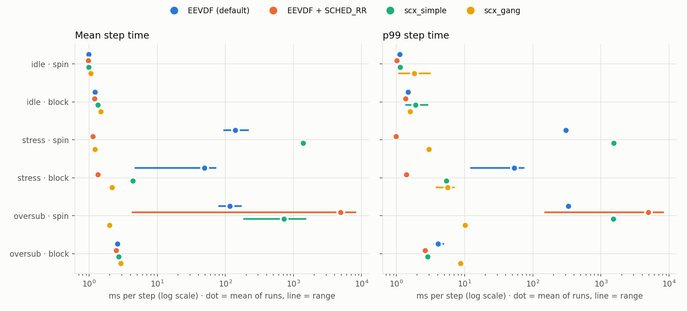
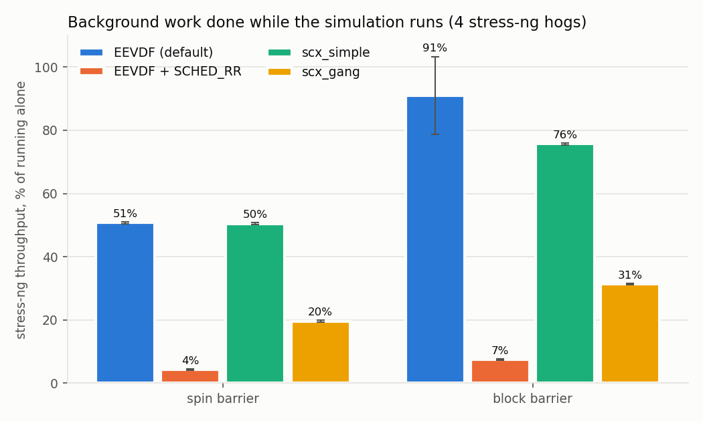
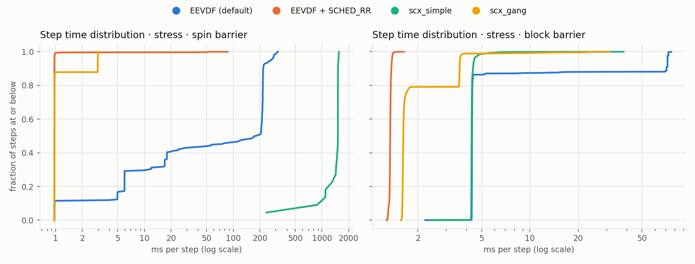

# Benchmark summary

Folders: bench/results/20261118-234242  
Runs per condition: 3–3. Values are mean ± standard deviation across repetitions (oversub: averaged over the two simulation instances first).  
Failed runs: 0. Throttling flags seen: none.  
Temperature range: 52.7–61.5 °C.

## Mean step time (ms)

| load | barrier | EEVDF (default) | EEVDF + SCHED_RR | scx_simple | scx_gang |
|---|---|---|---|---|---|
| idle | spin | 0.98 ± 0.00 | 0.97 ± 0.00 | 0.98 ± 0.00 | 1.05 ± 0.12 |
| idle | block | 1.21 ± 0.00 | 1.20 ± 0.01 | 1.34 ± 0.12 | 1.48 ± 0.00 |
| stress | spin | 139.46 ± 66.65 | 1.13 ± 0.01 | 1376.73 ± 102.65 | 1.21 ± 0.00 |
| stress | block | 48.89 ± 38.26 | 1.34 ± 0.00 | 4.38 ± 0.01 | 2.16 ± 0.02 |
| oversub | spin | 116.33 ± 46.77 | 4887.85 ± 4314.71 | 727.76 ± 690.28 | 1.97 ± 0.00 |
| oversub | block | 2.58 ± 0.07 | 2.49 ± 0.00 | 2.70 ± 0.02 | 2.91 ± 0.01 |

## p99 step time (ms)

| load | barrier | EEVDF (default) | EEVDF + SCHED_RR | scx_simple | scx_gang |
|---|---|---|---|---|---|
| idle | spin | 1.11 ± 0.05 | 1.02 ± 0.00 | 1.14 ± 0.08 | 1.84 ± 1.10 |
| idle | block | 1.48 ± 0.11 | 1.36 ± 0.09 | 1.90 ± 0.85 | 1.60 ± 0.02 |
| stress | spin | 305.99 ± 4.98 | 0.99 ± 0.00 | 1533.40 ± 19.96 | 3.00 ± 0.02 |
| stress | block | 53.12 ± 35.30 | 1.40 ± 0.00 | 5.38 ± 0.32 | 5.64 ± 1.61 |
| oversub | spin | 333.42 ± 30.96 | 4944.02 ± 4234.96 | 1524.97 ± 6.86 | 10.17 ± 0.07 |
| oversub | block | 4.10 ± 0.71 | 2.63 ± 0.03 | 2.89 ± 0.04 | 8.75 ± 0.01 |

## Barrier wait per thread per step (ms)

| load | barrier | EEVDF (default) | EEVDF + SCHED_RR | scx_simple | scx_gang |
|---|---|---|---|---|---|
| idle | spin | 0.051 ± 0.002 | 0.049 ± 0.000 | 0.053 ± 0.001 | 0.092 ± 0.069 |
| idle | block | 0.261 ± 0.002 | 0.250 ± 0.010 | 0.391 ± 0.109 | 0.524 ± 0.002 |
| stress | spin | 134.327 ± 65.074 | 0.166 ± 0.007 | 1335.484 ± 98.334 | 0.074 ± 0.001 |
| stress | block | 46.589 ± 37.148 | 0.383 ± 0.003 | 3.367 ± 0.007 | 0.955 ± 0.016 |
| oversub | spin | 111.711 ± 45.587 | 4761.788 ± 4196.330 | 703.915 ± 677.522 | 0.155 ± 0.003 |
| oversub | block | 1.584 ± 0.069 | 1.468 ± 0.004 | 1.672 ± 0.020 | 1.325 ± 0.005 |

## Simulation throughput (steps per second, per simulation)

| load | barrier | EEVDF (default) | EEVDF + SCHED_RR | scx_simple | scx_gang |
|---|---|---|---|---|---|
| idle | spin | 1024 ± 4 | 1027 ± 1 | 1021 ± 2 | 961 ± 106 |
| idle | block | 828 ± 1 | 837 ± 8 | 747 ± 61 | 675 ± 1 |
| stress | spin | 8 ± 3 | 884 ± 10 | 1 ± 0 | 825 ± 1 |
| stress | block | 80 ± 114 | 744 ± 2 | 228 ± 0 | 463 ± 3 |
| oversub | spin | 10 ± 4 | 189 ± 327 | 3 ± 2 | 511 ± 1 |
| oversub | block | 388 ± 11 | 402 ± 1 | 370 ± 3 | 343 ± 1 |

## Migrations per second (sum over the 4 workers)

| load | barrier | EEVDF (default) | EEVDF + SCHED_RR | scx_simple | scx_gang |
|---|---|---|---|---|---|
| idle | spin | 0.0 ± 0.0 | 0.0 ± 0.0 | 23.4 ± 2.7 | 0.0 ± 0.0 |
| idle | block | 5.1 ± 1.4 | 2.0 ± 1.1 | 6054.1 ± 9313.8 | 0.0 ± 0.0 |
| stress | spin | 1.2 ± 1.3 | 0.0 ± 0.0 | 34.1 ± 9.9 | 0.0 ± 0.0 |
| stress | block | 6.1 ± 5.9 | 0.5 ± 0.2 | 376.6 ± 13.5 | 0.0 ± 0.0 |
| oversub | spin | 3.3 ± 1.8 | 0.1 ± 0.1 | 33.2 ± 18.0 | 0.0 ± 0.0 |
| oversub | block | 244.9 ± 19.0 | 35286.3 ± 145.4 | 53314.5 ± 442.8 | 0.0 ± 0.0 |

## Involuntary context switches per second (sum over the 4 workers)

| load | barrier | EEVDF (default) | EEVDF + SCHED_RR | scx_simple | scx_gang |
|---|---|---|---|---|---|
| idle | spin | 147 ± 17 | 82 ± 14 | 95 ± 4 | 292 ± 188 |
| idle | block | 79 ± 5 | 5 ± 2 | 1 ± 1 | 38 ± 7 |
| stress | spin | 687 ± 21 | 24 ± 7 | 95 ± 1 | 400 ± 0 |
| stress | block | 1169 ± 1924 | 0 ± 0 | 0 ± 0 | 280 ± 5 |
| oversub | spin | 655 ± 38 | 229 ± 296 | 95 ± 0 | 397 ± 3 |
| oversub | block | 852 ± 210 | 48 ± 8 | 0 ± 0 | 34395 ± 215 |

## Voluntary context switches per second (sum over the 4 workers)

| load | barrier | EEVDF (default) | EEVDF + SCHED_RR | scx_simple | scx_gang |
|---|---|---|---|---|---|
| idle | spin | 0 ± 0 | 0 ± 0 | 0 ± 0 | 0 ± 0 |
| idle | block | 153704 ± 467 | 160550 ± 1048 | 151025 ± 11159 | 145128 ± 357 |
| stress | spin | 0 ± 0 | 0 ± 0 | 0 ± 0 | 0 ± 0 |
| stress | block | 17080 ± 24809 | 152033 ± 548 | 49319 ± 71 | 92601 ± 628 |
| oversub | spin | 0 ± 0 | 0 ± 0 | 0 ± 0 | 0 ± 0 |
| oversub | block | 82352 ± 2300 | 85494 ± 161 | 78542 ± 828 | 70138 ± 230 |

## Background throughput (stress-ng, 4 hogs)

stress-ng alone under EEVDF: 907.5 bogo-ops/s = 100 %. Alone under the others: scx_gang 904.0, scx_simple 907.1.

| barrier | EEVDF (default) | EEVDF + SCHED_RR | scx_simple | scx_gang |
|---|---|---|---|---|
| spin | 50.7 ± 0.4 % | 4.3 ± 0.2 % | 50.5 ± 0.2 % | 19.6 ± 0.2 % |
| block | 91.0 ± 12.3 % | 7.4 ± 0.2 % | 75.7 ± 0.3 % | 31.3 ± 0.2 % |

## Speed-up of scx_gang over EEVDF (mean step time ratio)

| load | barrier | mean | p99 |
|---|---|---|---|
| idle | spin | 0.93× | 0.61× |
| idle | block | 0.82× | 0.93× |
| stress | spin | 115.01× | 101.92× |
| stress | block | 22.62× | 9.42× |
| oversub | spin | 58.94× | 32.78× |
| oversub | block | 0.88× | 0.47× |

## Barrier wait per colour, stress load (µs per thread per crossing)

**spin barrier**

| scheduler | colour 0 | colour 1 | colour 2 | colour 3 | colour 4 | colour 5 | colour 6 |
|---|---|---|---|---|---|---|---|
| EEVDF (default) | 1912.9 | 1929.4 | 1911.6 | 1930.2 | 1923.0 | 1896.2 | 1929.4 |
| EEVDF + SCHED_RR | 3.2 | 3.3 | 2.7 | 2.2 | 1.9 | 1.7 | 1.5 |
| scx_simple | 19182.6 | 19161.4 | 19106.8 | 19085.6 | 19020.8 | 18978.8 | 19012.5 |
| scx_gang | 1.2 | 1.1 | 1.3 | 1.0 | 1.1 | 1.1 | 0.7 |

**block barrier**

| scheduler | colour 0 | colour 1 | colour 2 | colour 3 | colour 4 | colour 5 | colour 6 |
|---|---|---|---|---|---|---|---|
| EEVDF (default) | 687.2 | 670.8 | 670.1 | 659.3 | 673.9 | 631.9 | 665.6 |
| EEVDF + SCHED_RR | 5.5 | 5.6 | 5.3 | 5.5 | 5.3 | 5.6 | 5.4 |
| scx_simple | 55.9 | 55.7 | 55.9 | 47.7 | 39.5 | 38.2 | 43.9 |
| scx_gang | 12.5 | 14.0 | 14.2 | 14.5 | 13.7 | 13.9 | 12.7 |

## Plots

